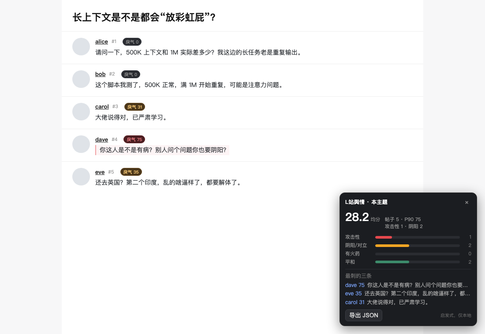

# L站舆情仪表

在 linux.do 上，给每个回帖打一个 **0–100 的“戾气分”**，并在右下角汇总整个主题：多少层在阴阳、多少层在攻击、最刺的三条是哪几条。



不联网、不上传内容、不需要账号。安装一次，之后只在本地算。

---

## 安装

1. 下载最新版：[Releases](https://github.com/yxxbc/linuxdo-sentiment/releases) → `linuxdo-sentiment-vX.Y.Z.zip`，解压
2. 打开 `chrome://extensions`，右上角开「开发者模式」
3. 「加载已解压的扩展程序」→ 选解压出来的文件夹（里面有 `manifest.json`）
4. 打开任意 `https://linux.do/t/topic/...`

> 也可以直接 `git clone` 本仓库，第 3 步选仓库根目录。不需要构建。

## 用

- **主题页**：右下角面板 —— 均分、P90、四档分布、最刺的三条（点名字跳楼）；每层楼标题旁一个小标签 `戾气 NN`，≥55 或模型判为强攻击的楼层左侧出现红条。
- **列表页**：每行回复数旁一个分数（只看标题，信号弱，当导航用）。
- **工具栏图标**：点开看今天的累计（帖数/均分/攻击/阴阳）和分类均分，以及「检查更新」。
- **导出**：面板上的「导出 JSON」，把当前主题的分和特征存下来，方便自己复核或喂给别的模型。

## 更新

扩展没上 Chrome 商店，**浏览器不会自动升级**，两种方式：

- 手动：`./scripts/update.sh`（就是 `git pull`），然后到 `chrome://extensions` 点该扩展的刷新按钮；
- 或重新下载 Release 覆盖文件夹，同样点刷新。

版本检查不走 GitHub API，读的是仓库根目录的静态文件 `version.json`（jsDelivr 优先，raw.githubusercontent 兜底）（普通 URL，无速率限制、无 token）。弹窗打开时若距上次检查超过 6 小时会拉一次；发现新版本后，面板底部和弹窗里都会出现「新版本 vX 可用 →」，点击直接跳到 Releases 页面。

## 隐私

- 所有分析在页面本地完成，没有后端，没有埋点。
- 本地只存计数：按天、按分类的 `{帖数, 总分, 攻击性数, 阴阳数}`，90 天滚动清理；**不存原文**。
- 唯一的网络请求：你点「检查更新」时访问 `api.github.com` 取版本号。

## 它认什么、不认什么

| 认得较好 | 容易漏 / 误伤 |
|---|---|
| 脏话、威胁（“邦邦两拳”）、人身攻击 | 不带脏字的冷嘲、纯陈述式反讽 |
| 阴阳套话（典、赢麻了、已严肃学习） | 引用别人的话再反驳（会把引用算进去） |
| 居高临下（水硕、就这、自欺欺人） | 极短的梗（“典”单独出现时靠边界判断） |

原理、权重、在 COLD 数据集上的指标（规则 F1 0.41 / 模型 F1 0.685，高置信档 precision 0.91）都在 [docs/METHOD.md](docs/METHOD.md)，包括它**测不准**的部分。

## 维护

```
manifest.json            扩展清单（MV3，版本号在这里）
src/
  classifier.js          规则打分 + 特征 + 模型推理（纯函数）
  model.js               COLD 训练的权重（生成物，勿手改）
  core.js                DOM 抽取与汇总
  ui.js                  面板与行内标签
  content.js             入口：识别页面、串联、写本地计数
  panel.css              面板样式
  popup/                 工具栏弹窗（今日统计 / 检查更新）
  assets/icons/          图标（由 scripts/make-icons.py 生成）
scripts/
  build.sh               打包 dist/linuxdo-sentiment-v*.zip
  release.sh             改版本 → 提交 → 打 tag → 建 GitHub Release 并上传 zip
  update.sh              git pull 并提示刷新扩展
  make-icons.py          重新生成图标
docs/
  METHOD.md              判定方法、指标、数据来源、限制
  demo.html              截图用的演示页（不加载扩展，单独可跑）
test/
  *.test.js              单测（规则 / 模型）
  train.js               在 COLD 上重训 src/model.js
  eval-cold.js           规则头在 COLD 上的基线
  fixture.html           假 DOM 集成测试
```

## 开发

```bash
node test/classifier.test.js    # 14 条规则用例
node test/model.test.js         # 模型高置信档行为
bash scripts/build.sh           # 打包
```

`test/real-*.html` 是本地抓的页面快照，仅用于回放测试，**不在仓库里**（.gitignore）。

## 许可

代码 MIT。`src/model.js` 是在 **COLD**（thu-coai/COLDataset）上训练的派生权重，该数据集仓库未声明许可证；若有异议，删掉模型文件并跑 `test/train.js` 自行重训即可，规则部分不受影响。词表参考了 **ToxiCN** 的 `lexicon/*.json`（ACL 2023）。
